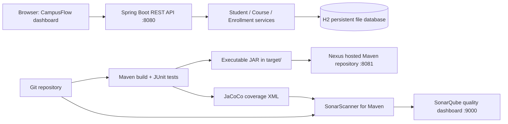

# CampusFlow: Java → Maven → Nexus Repository → SonarQube

> **DSU Global IT | Instructor: Karthikeya | Complete hands-on teaching lab**  
> **Stack:** Java 21 · Spring Boot 4.1.1 · Maven · H2 · JUnit/Mockito · JaCoCo · Nexus Repository · SonarQube · Docker Compose

This repository contains **one working Java web application** used throughout the entire DevOps tooling demonstration. Students first run the application, then learn Maven builds and tests, publish the **same JAR** to Nexus, and finally analyze the **same source code** in SonarQube.

**Not just a Hello World:** this is a small student/course enrollment system with a web dashboard, REST APIs, a persistent database, input validation, business rules, unit tests, and code coverage.

## Contents

1. [Application and workflow](#1-application-and-workflow)
2. [Prerequisites and installation on Ubuntu](#2-prerequisites-and-installation-on-ubuntu)
3. [Maven fundamentals, coordinates and POM](#3-maven-fundamentals-coordinates-and-pom)
4. [Maven build lifecycles](#4-maven-build-lifecycles)
5. [Maven command reference](#5-maven-command-reference)
6. [Build, test, run and try the application](#6-build-test-run-and-try-the-application)
7. [Start Nexus and SonarQube with Docker](#7-start-nexus-and-sonarqube-with-docker)
8. [Deploy the JAR artifact to Nexus](#8-deploy-the-jar-artifact-to-nexus)
9. [Analyze the SAME code in SonarQube](#9-analyze-the-same-code-in-sonarqube)
10. [Student exercises and demos](#10-student-exercises-and-demos)
11. [Troubleshooting and cleanup](#11-troubleshooting-and-cleanup)
12. [Documentation and safe operation](#12-documentation-and-safe-operation)

---

## 1. Application and workflow

**Scenario:** DSU Global IT is launching a training portal. Staff need to register students, open courses with fixed seat counts, and enroll students. The portal rejects duplicate email addresses, duplicate course codes, duplicate enrollments, and enrollment into a full class.

### System architecture



**End-to-end path:** `source code → mvn clean verify → tests and coverage → package JAR → mvn deploy → Nexus → sonar analysis → SonarQube dashboard`.

| App capability | REST endpoint | HTTP method |
|---|---|---|
| List students | `/api/students` | GET |
| Create student | `/api/students` | POST |
| Fetch student | `/api/students/{id}` | GET |
| List courses | `/api/courses` | GET |
| Create course | `/api/courses` | POST |
| List enrollments | `/api/enrollments` | GET |
| Enroll student in course | `/api/enrollments` | POST |
| Cancel enrollment | `/api/enrollments/{id}` | DELETE |
| Operational health | `/actuator/health` | GET |
| Web dashboard | `/` | GET |

### Repository layout

```text
campus-enrollment-maven-nexus-sonarqube/
├── README.md                            <-- YOU ARE HERE
├── pom.xml                              <-- Maven project (build, deps, artifact upload)
├── Dockerfile                           <-- optional Java container image
├── .gitignore                           <-- ignore DB, build outputs, secrets
├── src/
│   ├── main/
│   │   ├── java/com/dsuglobal/campus/
│   │   │   ├── CampusApplication.java
│   │   │   ├── controller/             <-- HTTP entry points
│   │   │   ├── service/                <-- business rules
│   │   │   ├── repository/             <-- database access
│   │   │   ├── model/                  <-- JPA entities
│   │   │   ├── dto/                    <-- request/response data
│   │   │   ├── exception/              <-- 400/404/409 responses
│   │   │   └── config/                 <-- sample data
│   │   └── resources/
│   │       ├── application.properties
│   │       └── static/index.html       <-- interactive frontend
│   └── test/java/com/dsuglobal/campus/service/
│       ├── StudentServiceTest.java
│       ├── CourseServiceTest.java
│       └── EnrollmentServiceTest.java
├── infra/
│   ├── docker-compose.yml              <-- Nexus + SonarQube + Sonar PostgreSQL
│   └── .env.example                     <-- copy to .env before docker compose
├── docs/
│   ├── settings-nexus.xml              <-- Maven credential template
│   ├── INSTRUCTOR-LAB.md               <-- teaching schedule + expected results
│   └── MAVEN-CHEATSHEET.md             <-- compact lifecycle and command sheet
└── scripts/
    ├── check-prereqs.sh
    └── demo-api.sh
```

### Meaning of each tool

| Tool | Simple definition | Output in this project |
|---|---|---|
| **JDK** | Compiles/executes Java | `.class` files, runtime |
| **Maven** | Builds Java apps and manages libraries | compiled code, tests, `.jar` |
| **JUnit + Mockito** | Test business logic and mock dependencies | pass/fail reports |
| **JaCoCo** | Measures which code tests execute | coverage HTML/XML |
| **Nexus Repository** | Stores and versions Maven artifacts | downloadable versioned JAR |
| **SonarQube** | Analyzes code maintainability, security, reliability, coverage | quality dashboard and gate |

> Telugu explanation: **Maven** అనేది Java code ని compile, test చేసి JAR గా package చేస్తుంది. **Nexus** ఆ JAR ని store చేసి ఇతర servers/teams కి అందిస్తుంది. **SonarQube** అదే source code quality, bugs, security rules, coverage ని check చేస్తుంది. Nexus = artifact storage; SonarQube = code analysis. They do NOT replace one another.

---

## 2. Prerequisites and installation on Ubuntu

### Lab host recommendation

For the application and Maven, a modest Linux lab is enough. **Running Nexus + SonarQube + its database together** is much heavier: ideally **4 vCPU, 8–12 GiB RAM, and ~20 GiB free disk**. Image downloads and startup take additional time. Small or time-limited iximiuz/KillerCoda labs may not have sufficient resources. You can run each service separately or use a VM with more RAM.

**Supported lab steps:** Ubuntu 22.04 / 24.04 (or a similar Linux distribution with `apt`, Java 21, Maven, Docker Compose v2). Commands below assume Ubuntu and `sudo`.

### Step 2.1: Install Java 21 and Maven

```bash
sudo apt update
sudo apt install -y openjdk-21-jdk maven curl unzip git
java -version
javac -version
mvn -version
```

Expected: `java -version` reports **21**; `mvn -version` reports an installed Maven 3.x and the Java 21 runtime. The Maven version installed via `apt` varies by Ubuntu release. The project uses the Spring Boot Maven plugin and Maven 3.6.3+; Maven 3.9+ is a good modern choice. If you need a newer version than your distro packages, install a supported Maven release from the official Apache Maven installation guide and update `PATH`.

**What is JAVA_HOME?** The JDK directory used by Java tools. If Maven is using the wrong JDK:

```bash
readlink -f "$(command -v java)"
# Example on common Ubuntu images (path may vary):
export JAVA_HOME=/usr/lib/jvm/java-21-openjdk-amd64
export PATH="$JAVA_HOME/bin:$PATH"
java -version && mvn -version
```

To save `JAVA_HOME` permanently, add the correct value to your shell profile. Do not blindly copy the example directory if your architecture is ARM64 or the JDK is installed elsewhere.

### Step 2.2: Install Docker Engine and Docker Compose (if not already installed)

On Ubuntu, follow Docker's **official Docker Engine install** instructions for your version. After installation:

```bash
docker --version
docker compose version
sudo systemctl enable --now docker
```

Use `sudo docker ...` if your current user lacks permission. Docker group membership effectively grants root-level access; do not casually grant it on shared servers. If your lab already has Docker, **do not reinstall it**.

Official docs: <https://docs.docker.com/engine/install/ubuntu/> and <https://docs.docker.com/compose/install/linux/>.

### Step 2.3: Get the project

Download the ZIP attached in chat, extract it and enter the project directory:

```bash
unzip campus-enrollment-maven-nexus-sonarqube.zip
cd campus-enrollment-maven-nexus-sonarqube
bash scripts/check-prereqs.sh
```

When cloning your own copy from GitHub later, use `git clone <your-repository-URL>` instead.

---

## 3. Maven fundamentals, coordinates and POM

**Maven = project object model + dependency management + plugins + a standardized lifecycle.**

`pom.xml` stands for **Project Object Model**. It tells Maven which project to build, which Java dependencies it needs, which plugins to run and where to upload the artifact.

| POM item | Current project value | Why it matters |
|---|---|---|
| `groupId` | `com.dsuglobal` | Organization/namespace |
| `artifactId` | `campus-enrollment-api` | Artifact/project identity |
| `version` | `1.0.0-SNAPSHOT` | Development version |
| `packaging` | `jar` | Build output type |
| `parent` | Spring Boot `4.1.1` | Managed compatible dependency/plugin versions |
| `dependencies` | Spring WebMVC, JPA, H2, validation, tests | Libraries used by the app |
| `build/plugins` | Spring Boot, JaCoCo, Sonar scanner | Executable JAR, coverage, analysis |
| `distributionManagement` | `maven-snapshots`, `maven-releases` | Nexus upload destination |

**Maven coordinates** are written as `groupId:artifactId:version`, for example:

```text
com.dsuglobal:campus-enrollment-api:1.0.0-SNAPSHOT
```

For the default version, the local output will be:

```text
target/campus-enrollment-api-1.0.0-SNAPSHOT.jar
```

**Three Maven repository concepts:**

1. **Local repository** (`~/.m2/repository`): dependency cache on the machine performing the build. `mvn install` also copies *this project's* JAR here.
2. **Central repository** (`repo.maven.apache.org`): public registry Maven normally downloads open-source dependencies from.
3. **Private remote repository** (**Nexus**): organization-managed place to publish artifacts and optionally proxy dependencies.

**Important:** `mvn install` and `mvn deploy` are **not the same**. `install` saves into your machine's local Maven cache. `deploy` publishes to a configured **remote Nexus repository**.

### Java source directory convention

```text
src/main/java/       production Java source
src/main/resources/  config + HTML frontend
src/test/java/       JUnit tests
pom.xml              build definition
target/               generated output (never push to Git)
```

---

## 4. Maven build lifecycles

Maven has **three built-in lifecycles**, not three phases:

| Lifecycle | Purpose | Common phases / command |
|---|---|---|
| **default** | Validate, compile, test, package, verify, install and deploy application | `mvn deploy` |
| **clean** | Delete old build output | `mvn clean` |
| **site** | Generate project documentation/report website | `mvn site` (plugin config may be required) |

### Common phases of the DEFAULT lifecycle (in execution order)

```text
validate → compile → test → package → verify → install → deploy
```

This is a simplified diagram; Maven also runs intermediate phases such as `process-resources`, `test-compile`, `integration-test`, and `post-integration-test` as applicable.

| Phase | What happens | Demo command | Typical result |
|---|---|---|---|
| `validate` | Check basic project configuration | `mvn validate` | POM validated |
| `compile` | Compile production `.java` | `mvn compile` | `target/classes/` |
| `test` | Compile & run unit tests | `mvn test` | `target/surefire-reports/` |
| `package` | Create JAR/WAR | `mvn package` | `target/*.jar` |
| `verify` | Perform verification tasks | `mvn verify` | JaCoCo HTML/XML report |
| `install` | Add artifact to local `~/.m2/repository` | `mvn install` | Cached JAR |
| `deploy` | Publish JAR/POM to Nexus remote repository | `mvn deploy` | Artifact in Nexus |

**VERY IMPORTANT teaching point:** `mvn package` does not only package; it **also runs all earlier phases** of the default lifecycle (including compilation and tests). Similarly `mvn deploy` runs all earlier phases. `mvn clean package` invokes the clean lifecycle first, then the default lifecycle through package.

**Goals vs phases:** `test` is a lifecycle phase, but `spring-boot:run` is a plugin goal. `mvn dependency:tree` runs a goal. `mvn clean verify` runs a lifecycle phase along with a clean phase. In Maven, the plugins implement actual work inside phases/goals.

---

## 5. Maven command reference

Run commands from the folder containing `pom.xml`.

| Command | What it does | Teacher demonstration |
|---|---|---|
| `mvn -version` | Show Maven and Java versions | Confirm installed |
| `mvn validate` | Validate project setup | Check POM structure |
| `mvn compile` | Compile main Java files | Inspect `target/classes/` |
| `mvn test` | Execute unit tests | Count successful tests |
| `mvn -Dtest=StudentServiceTest test` | Run one test class | Faster test loop |
| `mvn package` | Create JAR and run earlier phases | Inspect `target/*.jar` |
| `mvn -DskipTests package` | Skip running tests (still compiles tests) | Explain why risky |
| `mvn -Dmaven.test.skip=true package` | Skip compiling AND running tests | Explain difference |
| `mvn clean` | Delete `target/` | Confirm deletion |
| `mvn clean verify` | Fresh compile, tests, artifact and coverage | Recommended quality build |
| `mvn install` | Publish artifact into local Maven cache | Inspect `~/.m2/repository/com/dsuglobal/` |
| `mvn deploy` | Publish to Nexus per `distributionManagement` | Requires Nexus/settings |
| `mvn spring-boot:run` | Run app without manually invoking `java -jar` | Check port 8080 |
| `mvn dependency:tree` | Inspect transitive dependency tree | Show framework libraries |
| `mvn dependency:analyze` | Inspect used/unused declared dependencies | Investigate build hygiene |
| `mvn help:effective-pom` | View complete inherited POM | Show parent defaults |
| `mvn help:effective-settings` | View active settings (may expose secrets) | Handle privately |
| `mvn help:describe -Dcmd=deploy` | Inspect lifecycle phase behavior | Advanced concept |
| `mvn -U clean verify` | Force refresh eligible dependencies/snapshot metadata | Cache troubleshooting |
| `mvn -o test` | Run offline using cached dependencies | Demonstrate offline mode |
| `mvn -X test` | Verbose debug output | Investigate errors |
| `mvn -q test` | Quieter output | Contrast logs |
| `mvn clean verify -DskipTests` | Fast but no tests/coverage | Show coverage effects |
| `mvn jacoco:report` | Generate coverage report after instrumented test run | Inspect HTML output |
| `mvn sonar:sonar` | Short form for Sonar Maven plugin goal | Scanner in POM |

**Important:** `-DskipTests` produces no meaningful fresh coverage from tests. Do **not** skip tests before SonarQube analysis if you want a useful coverage metric. Also, a successful unit test run is not the same as a passing SonarQube Quality Gate.

---

## 6. Build, test, run and try the application

### Step 6.1: Build with Maven

```bash
mvn clean verify
```

Maven downloads dependencies on the first run (internet access is required), compiles Java, runs JUnit tests, packages the Spring Boot JAR, and generates the JaCoCo report.

**Inspect the generated output:**

```bash
ls -lh target/
ls -lh target/*.jar
ls -lh target/surefire-reports/
ls -lh target/site/jacoco/
```

Expected output paths:

```text
target/campus-enrollment-api-1.0.0-SNAPSHOT.jar
target/surefire-reports/
target/site/jacoco/index.html
target/site/jacoco/jacoco.xml
```

The `pom.xml` uses the Spring Boot Maven plugin to turn the regular JAR into an **executable fat JAR** containing the embedded server and runtime dependencies. It can be run directly with `java -jar`.

### Step 6.2: Run locally

```bash
java -jar target/campus-enrollment-api-1.0.0-SNAPSHOT.jar
```

Or, alternatively:

```bash
mvn spring-boot:run
```

**Do not run both commands simultaneously** on the same port. The web app is at `http://localhost:8080/`, and the health API is `http://localhost:8080/actuator/health`.

If this is a remote Ubuntu VM/lab, use the lab platform's forwarded URL for **port 8080** or an SSH tunnel; your laptop's `localhost` does not automatically point to the remote VM.

### Step 6.3: API tests (another terminal)

```bash
# Health
curl -i http://localhost:8080/actuator/health

# Sample student and course records are loaded on the first run
curl -s http://localhost:8080/api/students
curl -s http://localhost:8080/api/courses

# Create student
curl -i -X POST http://localhost:8080/api/students \
  -H 'Content-Type: application/json' \
  -d '{"name":"Meena Das","email":"meena@example.com"}'

# Create a course; capacity deliberately limited to one seat
curl -i -X POST http://localhost:8080/api/courses \
  -H 'Content-Type: application/json' \
  -d '{"code":"CLOUD401","title":"Cloud Architecture","capacity":1}'

# Get real IDs from the GET responses, then replace 1/1 below if needed.
curl -i -X POST http://localhost:8080/api/enrollments \
  -H 'Content-Type: application/json' \
  -d '{"studentId":1,"courseId":1}'

curl -s http://localhost:8080/api/enrollments

# Demo: repeat same request -> 409 Conflict (already enrolled)
# Demo: enroll two DIFFERENT students in a capacity-1 course -> second gets 409 Conflict
# Demo: missing student -> 404 Not Found
# Demo: invalid email -> 400 Bad Request
```

Optional convenience script while the server is up:

```bash
bash scripts/demo-api.sh
```

**Persistence:** app data is stored in `./data/campusdb.mv.db`. Stop the app before deleting `data/` to reset it. The `.gitignore` excludes database files. This H2 file database is ideal for teaching. Use a production-grade database, migrations, authentication, and a secrets solution before any serious deployment.

### Step 6.4: Inspect JaCoCo code coverage

Open `target/site/jacoco/index.html` in your editor/browser or forward it via your lab tool. This HTML report shows package/class/method coverage. SonarQube imports coverage from `target/site/jacoco/jacoco.xml`.

---

## 7. Start Nexus and SonarQube with Docker

### Step 7.1: Host preparation for SonarQube

```bash
# Linux host: kernel setting required by SonarQube/Elasticsearch
sudo sysctl -w vm.max_map_count=524288
sudo sysctl -w fs.file-max=131072

# Check how much RAM/disk is actually available
free -h
df -h
```

For permanent Linux configuration, use an appropriate file under `/etc/sysctl.d/` and apply it with `sudo sysctl --system`. On restricted managed labs, kernel tuning may be unavailable: use a more capable Docker host, or follow SonarQube's specific limited evaluation guidance.

### Step 7.2: Start containers

```bash
cd infra
cp .env.example .env
# IMPORTANT: edit .env and replace CHANGE_TO_A_LONG_RANDOM_PASSWORD
nano .env

docker compose up -d
# If you see Docker daemon permission errors, use sudo docker compose.
docker compose ps
docker compose logs --tail=50 nexus
docker compose logs --tail=50 sonarqube
```

Run Docker on a host that has enough RAM and can download images. The services can need several minutes on first start. Wait until the pages are responsive rather than assuming `docker compose up -d` means they are fully initialized.

| Service | Container name | Lab URL (on Docker host) | What it is |
|---|---|---|---|
| Nexus | `campus-nexus` | `http://localhost:8081` | Artifact repository UI |
| SonarQube | `campus-sonarqube` | `http://localhost:9000` | Code quality UI |
| PostgreSQL | `campus-sonar-db` | not published | SonarQube's database |

**Remote host note:** Replace `localhost` in your **browser** with the appropriate forwarded lab address or tunnel. The Maven commands in this README assume **Maven and Docker run on the same host**, so Maven can use `localhost:8081` and `localhost:9000`. If Maven runs elsewhere, update the URLs in `pom.xml` or override the appropriate Maven settings.

**Security note:** Compose maps `8081` and `9000` on all host interfaces to work with lab port forwarding. Run only in a private, isolated lab. Never expose these default-admin lab installations directly to the public internet. On your own secured computer, bind to `127.0.0.1` instead if you do not need remote access.

### Step 7.3: Get the initial Nexus admin password

```bash
# From the infra/ folder, after Nexus initializes:
docker exec campus-nexus cat /nexus-data/admin.password
```

Open `http://localhost:8081`, sign in as `admin` using that initial password, then follow the welcome wizard to **change the admin password**. Decide anonymous-access policy for your lab. The included example deploy uses the admin account for teaching only; real teams create a dedicated, least-privilege deploy user/role.

Nexus commonly includes these hosted repositories:

```text
maven-releases   -> release versions such as 1.0.0
maven-snapshots  -> development versions such as 1.0.0-SNAPSHOT
```

To verify, go to **gear icon → Repositories**. If missing, create repositories of type **maven2 (hosted)** with exactly those names. Use the matching version policy (`Release` or `Snapshot`). Do not use `maven-public` (a group repository) as an upload target.

### Step 7.4: Open SonarQube and set an admin password

Open `http://localhost:9000`. For a fresh SonarQube lab installation, default credentials are often `admin` / `admin`; change the password when prompted. Use SonarQube only when its startup is complete. You will configure an analysis project in Step 9.

---

## 8. Deploy the JAR artifact to Nexus

**Goal:** the JAR you created with Maven must appear in a **hosted Maven repository** that other developers and deployment pipelines can download.

### Step 8.1: Configure credentials, WITHOUT committing passwords

Return to project root:

```bash
cd ..

# Export credentials into this shell session only.
export NEXUS_USER=admin
read -rsp 'Nexus password: ' NEXUS_PASSWORD; echo
export NEXUS_PASSWORD

# docs/settings-nexus.xml references ${env.NEXUS_USER} and ${env.NEXUS_PASSWORD}
# You can safely use this template without editing or embedding the password.
```

The **`<server><id>`** elements in `docs/settings-nexus.xml` match the **`<repository><id>`** elements in `pom.xml`'s `<distributionManagement>`. This is how Maven matches credentials to a deployment target. Do not add passwords into `pom.xml`, `.env`, or source files that you commit.

If you already have an `~/.m2/settings.xml`, merge the `<servers>` entries rather than overwriting it. This lab runs Maven with `-s docs/settings-nexus.xml` so students do not need to modify their global settings file.

### Step 8.2: Publish the SNAPSHOT artifact

```bash
mvn -s docs/settings-nexus.xml clean deploy
```

Since `pom.xml` contains `<version>1.0.0-SNAPSHOT</version>`, Maven publishes into **`maven-snapshots`**. Maven runs the full lifecycle through deploy: compile, test, package, verify, install, then upload.

Look for a **`BUILD SUCCESS`** and `Uploading to nexus-snapshots` lines. In Nexus UI navigate to **Browse → maven-snapshots → com → dsuglobal → campus-enrollment-api → 1.0.0-SNAPSHOT**. You should see the Maven metadata, POM, and a JAR. The repository stores versioned snapshot metadata, so the actual downloaded JAR often has a timestamped filename.

### Step 8.3: Verify by downloading the uploaded JAR

For a quick manual verification, use the **Browse** view in Nexus and download the timestamped `.jar` asset. Then run:

```bash
java -jar /path/to/downloaded/campus-enrollment-api-*.jar
```

Use the actual downloaded file path and ensure there is only one matching JAR. You are now **running an artifact retrieved from Nexus**, not a new source build.

**Advanced reproducible verification (when Nexus allows read access):**

```bash
# First stop the running app on port 8080.
# Maven resolves latest snapshot using repository metadata, with the same credentials.
mvn -s docs/settings-nexus.xml dependency:get \
  -Dartifact=com.dsuglobal:campus-enrollment-api:1.0.0-SNAPSHOT \
  -DremoteRepositories=nexus-snapshots::default::http://localhost:8081/repository/maven-snapshots/ \
  -Dtransitive=false
```

The goal caches the artifact in `~/.m2/repository/`. You may need to remove the already-cached local copy or run in a separate local repository to **prove the bytes came from Nexus**, because `mvn deploy` also installs the same artifact locally.

### Step 8.4: Release vs SNAPSHOT demo

| Development | Stable release |
|---|---|
| `1.0.0-SNAPSHOT` | `1.0.0` |
| Nexus `maven-snapshots` | Nexus `maven-releases` |
| Typically repeated builds supported | Release repository commonly blocks redeployment |

To demonstrate a real release, **after the SNAPSHOT lab**, change the version in `pom.xml` from `1.0.0-SNAPSHOT` to `1.0.0`, then run `mvn -s docs/settings-nexus.xml clean deploy`. A release artifact appears under `maven-releases`. If you want to run that release with `java -jar`, use the new `target/campus-enrollment-api-1.0.0.jar` filename.

> For enterprise projects: do NOT casually replace already published immutable release binaries. Produce a *new version* for each release.

---

## 9. Analyze the SAME code in SonarQube

### Step 9.1: Create SonarQube project and token

1. Open `http://localhost:9000` and log in.
2. Under **Projects**, create a new **local** project. Use **Project Key** `campus-enrollment-api` and a suitable name.
3. Choose **local analysis / Maven** (UI labels differ by version).
4. Create an **analysis token** with permission to execute analysis on this project (typically under project setup or **My Account → Security**). Copy it immediately and keep it private.
5. Return to the project root in your terminal and export the token without writing it into the Git repository:

```bash
read -rsp 'Sonar token: ' SONAR_TOKEN; echo
export SONAR_TOKEN
```

### Step 9.2: Generate test coverage and upload an analysis

From project root, while SonarQube is accessible on port 9000:

```bash
mvn clean verify

mvn org.sonarsource.scanner.maven:sonar-maven-plugin:5.5.0.6356:sonar \
  -Dsonar.host.url=http://localhost:9000
```

The scanner reads the `SONAR_TOKEN` environment variable. The project key and JaCoCo XML path are already specified in `pom.xml`. Running `verify` **before** analysis ensures compiled classes and the XML coverage report exist.

Equivalent combined command:

```bash
mvn clean verify org.sonarsource.scanner.maven:sonar-maven-plugin:5.5.0.6356:sonar \
  -Dsonar.host.url=http://localhost:9000
```

### Step 9.3: Inspect the SonarQube dashboard

Open the `campus-enrollment-api` project in SonarQube. Inspect **Issues**, **Measures**, **Security**, **Reliability**, **Maintainability**, **Coverage**, **Duplications**, and **Quality Gate** (UI labels may differ). No code base is guaranteed to have a specific issue count or gate status: record the actual results of the lab.

| Tool output | Where to inspect | Meaning |
|---|---|---|
| JUnit result | `target/surefire-reports/` | Pass/fail and test count |
| JaCoCo report | `target/site/jacoco/index.html` | Actual test execution coverage |
| SonarQube Issues | Project dashboard | Static code analysis observations |
| SonarQube Coverage | Project dashboard | Imported JaCoCo report coverage |
| SonarQube Quality Gate | Project dashboard | Rule-based pass/fail decision |

**Do not confuse these:** The SonarScanner does not execute JUnit tests; Maven does. SonarQube does not store your JAR; Nexus does. SonarQube displays JaCoCo coverage but does not generate coverage by itself.

### Step 9.4: Demonstrate code-quality feedback

In a teaching branch (not `main`), temporarily add a deliberately unused local variable or duplicate a small method block. Run `mvn clean verify ...:sonar` and compare the analysis. Not every change creates a Sonar issue; results depend on the current rule profile. Revert the teaching change after demonstration.

**Further professional workflow:** In a CI/CD pipeline, the quality gate can block a release, and published artifacts can be promoted only after the tests and quality checks pass. The two manual operations in this lab are deliberately separate to make the tool roles obvious.

---

## 10. Student exercises and demos

The exercise sheet is in **[`docs/INSTRUCTOR-LAB.md`](docs/INSTRUCTOR-LAB.md)**. Suggested sequence:

| Lab | Task | Learning outcome |
|---|---|---|
| 1 | Run app; add student/course/enrollment via dashboard | Understand the software |
| 2 | Run `mvn validate`, `compile`, `test`, `package` | Explain phases |
| 3 | Show failing test; fix code; rerun | Understand quality checks |
| 4 | Run `clean verify`; open JaCoCo report | Understand coverage |
| 5 | Run `install` and inspect `~/.m2` | Local Maven repository |
| 6 | Start Nexus and inspect hosted repos | Remote artifact repository |
| 7 | Run `deploy` and browse Nexus | Publishing versions |
| 8 | Pull JAR from Nexus and run it | Artifact promotion concept |
| 9 | Run SonarScanner; inspect issues and coverage | Static analysis and quality gates |
| 10 | Assign final individual challenge | End-to-end learning check |

---

## 11. Troubleshooting and cleanup

| Symptom | Cause / fix |
|---|---|
| `mvn: command not found` | Install Maven; check PATH; rerun `mvn -version`. |
| `release version ... not supported` | Wrong JDK; use Java 21 and check `mvn -version` Java entry. |
| `Could not resolve dependencies` | Network/DNS/proxy or Maven Central restrictions; first build requires internet. |
| `Address already in use: 8080` | Another Java server is running; stop it or set `PORT=8082`. |
| Nexus UI not up yet | `docker compose logs -f nexus`; check disk/RAM and wait for initialization. |
| `admin.password` not found | Nexus not yet initialized, wrong container, or initial password already removed after setup. |
| Nexus deployment `401` | Invalid username/password or expired/incorrect credentials. |
| Nexus deployment `403` | User does not have repository add/edit permissions. |
| Nexus deployment `404` | Check repository names and `<distributionManagement>` URLs. |
| Nexus `400` during deploy | Snapshot sent to release repo, or trying to redeploy an immutable release. |
| `Blocked mirror for repositories: [maven-default-http-blocker]` | Maven may block external HTTP repos. This local-host Nexus lab should normally be exempt. Production Nexus should use HTTPS; avoid disabling security globally. |
| SonarQube reports Elasticsearch error | Check `vm.max_map_count`, available RAM, and container logs. |
| SonarQube starts then stops | Insufficient RAM, file limits, database errors; inspect logs. |
| SonarScanner `401` / `Not authorized` | Wrong token, missing `SONAR_TOKEN`, or project permissions. |
| Sonar project `not found` | Create correct project key and provide analysis permission. |
| Coverage shows 0% | Run `mvn clean verify` before scan; confirm `target/site/jacoco/jacoco.xml`. |
| Docker running remote, Java client on laptop | `localhost` is the wrong machine; configure forwarding and host URLs. |
| App data changed after rerun | H2 persists intentionally. Remove `data/` only after stopping the app. |
| Can't connect to Nexus from `mvn` inside a container | `localhost` points to the *Maven container*, not the host; use correct Docker DNS/network. |

### Cleanup (preserve volumes unless you intentionally delete them)

```bash
# Stop the Java process with Ctrl+C, then:
cd infra
docker compose down             # stop/remove containers; preserves stored data
# For a FULL RESET: DELETES ALL NEXUS REPOS, SONARQUBE DATA AND SONAR DB
# docker compose down -v        # destructive; only use for intentional reset
cd ..
mvn clean                       # delete local build artifacts
# rm -rf data/                  # OPTIONAL: remove local H2 data only after stopping app
```

---

## 12. Documentation and safe operation

**Environment assumptions:** Maven and Docker services run on the same Linux lab host, and outbound access to Maven Central and container registries is available. The Compose stack has **no security hardening for public production deployment**. Always use least-privilege service accounts/users, HTTPS, private endpoints, patched versions, durable backup and proper credential management in real environments.

**Why this is a training app rather than a full production application:** It uses file-based H2 and no user authentication, has basic but non-exhaustive tests, and uses JPA schema auto-update. Production work should add PostgreSQL/MySQL as the app database, Flyway/Liquibase migrations, API authorization, integration tests, observability, secrets and CI/CD controls.

**Further reading (official):**

- Maven introduction / lifecycles: <https://maven.apache.org/guides/introduction/introduction-to-the-lifecycle.html>
- Maven installation: <https://maven.apache.org/install.html>
- Spring Boot Maven plugin: <https://docs.spring.io/spring-boot/reference/build-tool-plugins/maven-plugin.html>
- Nexus Maven repositories: <https://help.sonatype.com/en/maven-repositories.html>
- Nexus Docker image: <https://help.sonatype.com/en/cloud-deployments.html>
- SonarScanner for Maven: <https://docs.sonarsource.com/sonarqube-server/analyzing-source-code/scanners/sonarscanner-for-maven>
- SonarQube Docker image: <https://hub.docker.com/_/sonarqube>
- Docker Engine Ubuntu: <https://docs.docker.com/engine/install/ubuntu/>

**Licensing:** The Java application code in this educational starter is provided for hands-on training; dependencies, Nexus, SonarQube and Docker images retain their own terms/licenses. Review those terms before reuse.
